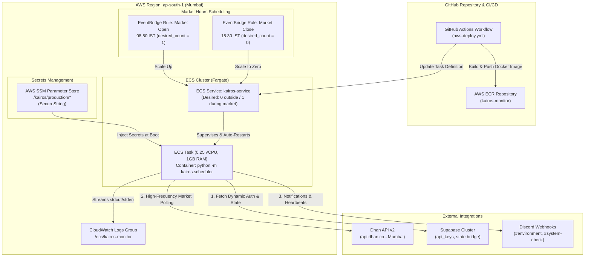
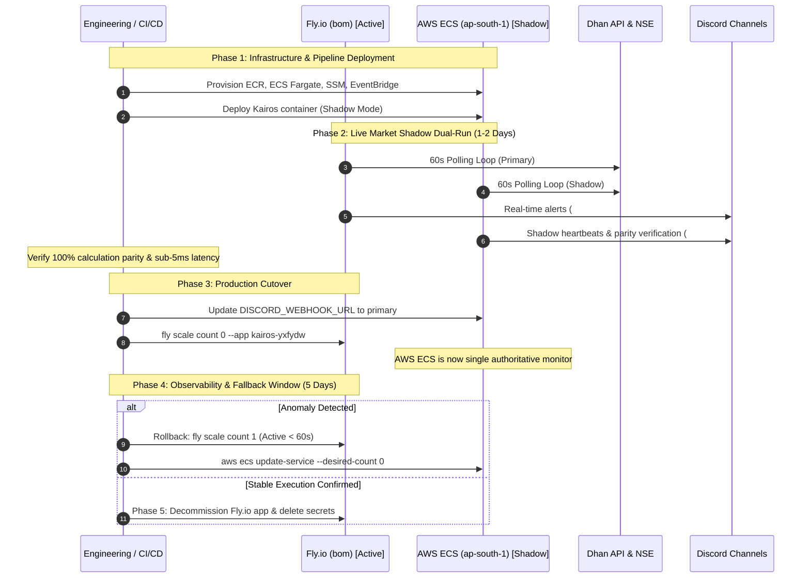

# TASK-260: Fly.io to AWS Migration Architecture

**Task ID:** MANM-260  
**Date:** 2026-10-16  
**Status:** Proposed; awaiting human approval before Code Generator dispatch  
**Target Region:** AWS Mumbai (`ap-south-1`)  
**Supersedes/Amends:** ADR-019 (Fly.io Docker Deployment), ADR-020 (Fly.io Scale-to-Zero and Automatic Shutdown)

---

## 1. Problem Statement

Kairos currently operates as a headless scalping environment monitor deployed to Fly.io in the `bom` (Mumbai) region (`fly.toml`, app `kairos-yxfydw`) utilizing a shared-cpu-1x instance (1 vCPU, 1GB RAM). While Fly.io has delivered acceptable low-latency execution to the Indian markets, the engineering organization is evaluating a strategic consolidation onto AWS infrastructure.

The migration must accommodate the following strict runtime and business constraints:
1. **Geographic Proximity & Latency:** Minimal network latency to Dhan API servers and Indian market feeds (NSE) located in Mumbai; deployment must reside within AWS Mumbai (`ap-south-1`).
2. **Daemon Lifecycle & Stateful In-Memory Buffers:** Kairos executes headlessly via `python -m kairos.scheduler`. Unlike request-response web apps, it runs a persistent 60-second polling loop maintaining rolling in-memory candle buffers (`deque` of completed 1-minute OHLCV bars) and a 15-minute rolling window for Open Interest (OI) flow and consensus indicators during trading hours (09:15–15:30 IST). Stateless/ephemeral serverless architectures (e.g., standard API Gateway + AWS Lambda) are fundamentally unsuitable due to the loss of in-memory indicator history across cold starts.
3. **Automated Supervision & Failure Recovery:** Process crashes, unhandled exceptions, or transient network partitions must trigger automatic container restarts without human intervention during trading hours.
4. **Market Hours Cost Optimization:** Indian markets operate Monday through Friday from 09:15 to 15:30 IST (~6.5 hours/day, ~143 hours/month). The compute infrastructure should support scaling to zero outside market hours or provide an extremely low 24/7 baseline cost.
5. **Zero-Trust Secrets & Credentials:** Dhan access tokens expire every 24 hours. Under ADR-022, dynamic tokens are fetched from Supabase (`api_keys` table) on startup and refreshed mid-session upon 401 errors. Static bootstrap credentials (`SUPABASE_URL`, `SUPABASE_KEY`, Discord webhooks) must be injected securely without committing secrets to source control or baking them into container images.

---

## 2. Infrastructure Comparison & Trade-Off Matrix

We evaluated four candidate AWS compute architectures against the baseline Fly.io deployment:
1. **AWS ECS on Fargate (`ap-south-1`)**
2. **AWS App Runner (`ap-south-1`)**
3. **AWS Lightsail Containers & Lightsail Linux VPS (`ap-south-1`)**
4. **AWS EC2 (t4g.micro / t4g.small ARM64 in `ap-south-1`)**

### 2.1 Trade-Off Matrix

| Evaluation Dimension | Existing: Fly.io (`bom`) | Candidate 1: AWS ECS on Fargate (`ap-south-1`) **[RECOMMENDED]** | Candidate 2: AWS App Runner (`ap-south-1`) **[REJECTED]** | Candidate 3: AWS Lightsail VPS / Containers (`ap-south-1`) **[REJECTED]** | Candidate 4: AWS EC2 t4g.micro (`ap-south-1`) **[VIABLE SECONDARY]** |
|---|---|---|---|---|---|
| **Monthly Compute Cost (Market Hours Scheduled)** | ~$1.95 – $3.20 / mo (scaled to zero via Actions) | **~$2.15 / mo** (0.25 vCPU, 1 GB RAM, 143 hrs/mo) | N/A (Cannot pause background daemon cleanly) | ~$5.00 / mo (VPS is flat 24/7; no native scheduler) | **~$1.84 / mo** (Stopped outside hours + 8GB gp3 EBS) |
| **Monthly Compute Cost (24/7 Continuous)** | ~$5.70 / mo | ~$10.63 / mo | ~$15.00 – $56.00 / mo (CPU throttled vs provisioned) | $5.00 / mo (Fixed flat rate) | ~$6.77 / mo ($6.13 instance + $0.64 EBS) |
| **Network Latency to Dhan API / NSE** | 2–6 ms (`bom`) | **2–5 ms** (`ap-south-1`) | 2–5 ms (`ap-south-1`) | 2–6 ms (`ap-south-1`) | 2–5 ms (`ap-south-1`) |
| **Headless Daemon Fit (No Inbound HTTP Port)** | Native (Background container worker) | **Native (ECS task / service with no load balancer)** | **Poor** (Requires dummy HTTP server & health check probe) | Native (systemd service or standalone Docker) | Native (`kairos.service` via systemd or Docker) |
| **Process Failure Auto-Restart** | Fly Machine auto-restart on non-zero exit | **Native ECS Service auto-restart (`desired_count=1`)** | App Runner container restart | systemd (`Restart=always`) | systemd (`Restart=always`) |
| **Market-Hours Scheduling** | GitHub Actions cron (`flyctl scale count 1/0`) | **Amazon EventBridge Scheduled Rules (UpdateService desired_count 1/0)** | Not natively supported for non-HTTP workloads | Manual cron / API scripting | EventBridge + SSM/Lambda to start/stop instance |
| **Secrets Management** | `flyctl secrets` (encrypted vault) | **AWS SSM Parameter Store (SecureString, zero cost)** | App Runner environment variables (plain/KMS) | Plaintext `.env` on disk | IAM Instance Profile + SSM Parameter fetch on boot |
| **Operational & Maintenance Overhead** | Low (PaaS CLI, no OS management) | **Very Low** (Serverless containers, zero OS patching, managed logs) | Medium (Custom HTTP server shim required) | High (OS patching, SSH key rotation, manual updates) | Medium-High (OS patching, AMI rotation, EBS maintenance) |
| **Logging & Telemetry** | `fly logs` / Vector drain | **CloudWatch Logs via native `awslogs` driver** | CloudWatch Logs (App Runner standard) | Local `journalctl` / manual CloudWatch agent | CloudWatch unified agent forwarding `journald` |
| **CI/CD Deployment** | GitHub Actions (`flyctl deploy`) | **GitHub Actions (`docker build` → ECR → ECS Deploy)** | GitHub Actions (App Runner service update) | SSH runner / manual pull | SSH / SSM Run Command / CodeDeploy |

---

## 3. Candidate Architectural Analysis & Decisions

### 3.1 Candidate 1: AWS ECS on Fargate (`ap-south-1`) — Primary Architectural Choice

**Rationale:**
- **Zero Host Maintenance:** Fargate completely abstracts EC2 instances, AMI maintenance, operating system patching, and disk volume management.
- **Cost Parity with Fly.io:** Sizing the task at 0.25 vCPU (256 CPU units) and 1.0 GB RAM matches Kairos’s real footprint. At AWS `ap-south-1` rates ($0.04048/vCPU-hour and $0.004445/GB-hour), operating only during trading hours (143 hours/month) totals **$2.09/month** for compute, rivaling Fly.io’s scale-to-zero pricing. Even if run 24/7, the cost is a modest $10.63/month.
- **Native Daemon Supervision:** Running Kairos under an ECS Service with `desired_count=1` provides automatic, rapid container rescheduling if the Python process terminates due to unhandled exceptions, memory exhaustion, or network failures.
- **Scheduled Scale-to-Zero:** Amazon EventBridge scheduled rules trigger an `UpdateService` call setting `desired_count=1` at 08:50 IST and `desired_count=0` at 15:30 IST on weekdays, cleanly orchestrating market-hours compute without third-party cron tools.
- **First-Class AWS Security:** Native task execution roles securely inject SSM Parameter Store SecureString parameters directly as environment variables at container launch without writing secrets to disk.

### 3.2 Candidate 2: AWS App Runner (`ap-south-1`) — Rejected

**Rationale for Rejection:**
- **Web-Service Bias:** App Runner is purpose-built for request-driven web applications listening on a TCP/HTTP port. It requires an active HTTP health-check endpoint (`/health` or `/`). Because Kairos is an autonomous polling daemon (`python -m kairos.scheduler`), App Runner would reject the deployment unless an artificial HTTP server (e.g., FastAPI / aiohttp) was added purely as dummy scaffolding.
- **CPU Throttling:** App Runner automatically throttles CPU when no inbound HTTP requests are received unless provisioned concurrency is purchased, starving Kairos's background polling loop and indicator calculations.
- **Cost Inefficiency:** Minimum provisioned memory costs ~$10.22/month plus active compute charges, making it significantly more expensive than ECS Fargate for background workloads.

### 3.3 Candidate 3: AWS Lightsail Containers / Linux VPS (`ap-south-1`) — Rejected

**Rationale for Rejection:**
- **Lightsail Containers:** The Micro container tier costs a flat $10/month 24/7 with rigid scheduling capabilities, lack of fine-grained IAM task role integration, and no native SSM Parameter Store secret injection.
- **Lightsail Linux VPS:** While economical ($3.50–$5.00/month flat), a standalone VPS introduces significant administrative overhead: manual OS patching, SSH credential lifecycle, failure alerting, and lack of cloud-native CI/CD automation.

### 3.4 Candidate 4: AWS EC2 (t4g.micro / t4g.small in `ap-south-1`) — Viable Secondary Alternative

**Evaluation:**
- A Graviton2 `t4g.micro` instance (2 vCPU, 1 GB RAM) costs ~$6.13/month 24/7 or ~$1.84/month if stopped outside market hours. It runs native systemd (`kairos.service`) with battle-tested `Restart=always` semantics.
- However, EC2 requires managing Linux AMIs, security patches, EBS volume snapshots, and scheduling scripts. ECS on Fargate provides identical reliability and latency without any host administration burden, making Fargate the superior enterprise choice.

---

## 4. Architectural Design & Component Specifications



### 4.1 Compute & Task Specification
- **Service Type:** AWS ECS on Fargate (No load balancer, private subnet with NAT Gateway or public subnet with assigned public IP and egress-only security group).
- **Task CPU:** 256 CPU units (0.25 vCPU).
- **Task Memory:** 1024 MB (1.0 GB).
- **Architecture:** Linux / X86_64 or ARM64 (matched to multi-stage Docker build).
- **Container Entrypoint:** `CMD ["python", "-m", "kairos.scheduler"]`.

### 4.2 Daemon Lifecycle & Schedule Management
- **Pre-Market Wakeup (08:50 IST / 03:20 UTC, Mon–Fri):**
  - EventBridge cron expression: `cron(20 3 ? * MON-FRI *)`
  - Target: `ecs:UpdateService` on `kairos-service` with `desiredCount: 1`.
  - Gives the container 25 minutes prior to market open (09:15 IST) to:
    1. Authenticate with Supabase and fetch active Dhan credentials (`load_dhan_credentials_from_supabase()`).
    2. Warm up historical daily and intraday levels.
    3. Initialize in-memory OHLCV candle deques.
    4. Post initial session readiness heartbeat to Discord (`#system-check`).
- **Post-Market Scale-to-Zero (15:30 IST / 10:00 UTC, Mon–Fri):**
  - EventBridge cron expression: `cron(0 10 ? * MON-FRI *)`
  - Target: `ecs:UpdateService` on `kairos-service` with `desiredCount: 0`.
  - Kairos internally triggers `sys.exit(0)` at `15:25 IST` once post-market wrap-up and final Discord alerts conclude. Setting `desired_count=0` at 15:30 IST ensures ECS does not treat the planned exit as a failure and prevents spawning new tasks until the next morning.
- **Intra-Day Crash Auto-Restart:**
  - Between 08:50 and 15:30 IST, `desired_count` is 1. If the container process terminates with a non-zero exit code, ECS automatically provisions a replacement container within ~20–30 seconds.

---

## 5. Secrets Management Strategy

### 5.1 Dynamic Dhan Token Architecture (ADR-022 Compliance)
Under ADR-022, Dhan access tokens expire every 24 hours and are renewed by a centralized authentication daemon into Supabase's `public.api_keys` table. Kairos reads these dynamically at startup via `load_dhan_credentials_from_supabase()` and refreshes them mid-session if a `401 Unauthorized` is encountered.
**Therefore, no Dhan API tokens, client secrets, or TOTP seeds are stored in AWS infrastructure.**

### 5.2 Bootstrap Secrets in AWS SSM Parameter Store
The application requires only four bootstrap configuration secrets:
1. `SUPABASE_URL`
2. `SUPABASE_KEY`
3. `DISCORD_WEBHOOK_URL`
4. `DISCORD_HEALTH_WEBHOOK_URL`

**Storage & Hierarchy:**
Stored in AWS Systems Manager Parameter Store under the `/kairos/production/` path with type `SecureString` encrypted via default KMS key `alias/aws/ssm`:
- `/kairos/production/SUPABASE_URL`
- `/kairos/production/SUPABASE_KEY`
- `/kairos/production/DISCORD_WEBHOOK_URL`
- `/kairos/production/DISCORD_HEALTH_WEBHOOK_URL`

**ECS Secret Injection Schema:**
The ECS Task Execution Role is granted IAM permission `ssm:GetParameters` and `kms:Decrypt`. The container definition references the parameters directly:
```json
{
  "name": "kairos-monitor",
  "image": "<aws_account_id>.dkr.ecr.ap-south-1.amazonaws.com/kairos-monitor:latest",
  "secrets": [
    { "name": "SUPABASE_URL", "valueFrom": "arn:aws:ssm:ap-south-1:<account>:parameter/kairos/production/SUPABASE_URL" },
    { "name": "SUPABASE_KEY", "valueFrom": "arn:aws:ssm:ap-south-1:<account>:parameter/kairos/production/SUPABASE_KEY" },
    { "name": "DISCORD_WEBHOOK_URL", "valueFrom": "arn:aws:ssm:ap-south-1:<account>:parameter/kairos/production/DISCORD_WEBHOOK_URL" },
    { "name": "DISCORD_HEALTH_WEBHOOK_URL", "valueFrom": "arn:aws:ssm:ap-south-1:<account>:parameter/kairos/production/DISCORD_HEALTH_WEBHOOK_URL" }
  ],
  "environment": [
    { "name": "LOG_LEVEL", "value": "INFO" },
    { "name": "POLL_INTERVAL_SECONDS", "value": "60" }
  ]
}
```
The ECS agent injects these values into the container environment prior to entrypoint execution. Kairos's `Settings` object in `src/kairos/config.py` loads them seamlessly via `pydantic_settings` without requiring code modifications.

---

## 6. Zero-Downtime Rollout & Shadow Dual-Run Strategy

To eliminate operational risk during migration, we mandate a phased rollout featuring live shadow verification against market data before decommissioning Fly.io.



### 6.1 Phase 1: Infrastructure Provisioning (Zero Production Impact)
1. Deploy AWS ECR repository `kairos-monitor`.
2. Populate SSM Parameter Store parameters under `/kairos/production/`.
3. Create ECS Fargate Cluster `kairos-cluster` and task definition.
4. Establish GitHub Actions workflow `.github/workflows/aws-ecs-deploy.yml` with OIDC role assumption.

### 6.2 Phase 2: Live Market Shadow Dual-Run (1 to 2 Trading Days)
1. Launch AWS ECS task with `DISCORD_WEBHOOK_URL` pointed to a dedicated shadow channel (e.g., `#environment-aws-shadow`) and `DISCORD_HEALTH_WEBHOOK_URL` pointed to `#system-check`.
2. Keep Fly.io actively posting to the primary `#environment` channel.
3. Validate:
   - **Data Feed Parity:** Ensure rolling candle upserts and indicator outputs (IV contraction, OI Flow scores, Trend Phase) on AWS match Fly.io within the same 60-second cycle.
   - **Network Latency:** Confirm round-trip latency to `api.dhan.co` from `ap-south-1` is ≤ 5ms.
   - **Supabase Token Refresh:** Verify dynamic credentials update properly upon 24h expiration.
   - **EventBridge Scale-to-Zero:** Confirm clean shutdown at 15:25–15:30 IST and automatic startup at 08:50 IST.

### 6.3 Phase 3: Production Cutover
1. Update AWS ECS task definition parameter `DISCORD_WEBHOOK_URL` to point to the live `#environment` channel.
2. Scale Fly.io machine count to zero:
   ```bash
   fly scale count 0 --app kairos-yxfydw
   ```
3. Disable Fly.io GitHub Actions deployment and scaling workflows (`fly-deploy.yml`).
4. Monitor opening bell execution (09:15 IST) on AWS ECS Fargate.

### 6.4 Phase 4: Rollback Runbook (Standby Duration: 5 Trading Days)
If AWS ECS experiences unexpected container failures, network degradation, or scheduling anomalies:
1. Immediately re-enable Fly.io compute (recovery time < 60 seconds):
   ```bash
   fly scale count 1 --app kairos-yxfydw
   ```
2. Scale down AWS ECS task:
   ```bash
   aws ecs update-service --cluster kairos-cluster --service kairos-service --desired-count 0 --region ap-south-1
   ```
3. Fly.io resumes authoritative monitoring while diagnostics are performed on AWS CloudWatch logs.

### 6.5 Phase 5: Decommissioning
Following 5 consecutive days of uninterrupted trading on AWS ECS Fargate:
- Decommission Fly.io application `kairos-yxfydw`.
- Remove `FLY_API_TOKEN` from GitHub Actions repository secrets.
- Archive `fly.toml`.

---

## 7. Component Boundaries & File Assignments for Code Generator

Implementation of this architecture is assigned to the **Code Generator Agent** upon human approval. The implementation must strictly adhere to the following file boundaries:

| File Path | Component / Responsibility | Action |
|---|---|---|
| `infra/terraform/` or `infra/cloudformation/` | AWS infrastructure definitions (ECR, ECS Fargate cluster, task definition, IAM execution roles, CloudWatch log group, EventBridge rules) | Create |
| `.github/workflows/aws-ecs-deploy.yml` | CI/CD pipeline: build multi-stage Docker image, push to ECR, deploy new task definition to ECS service | Create |
| `.github/workflows/fly-deploy.yml` | Deprecate Fly.io deployment workflow (archive / disable) upon cutover completion | Update |
| `fly.toml` | Retain as rollback baseline until Phase 5 decommissioning | Preserve |
| `src/kairos/config.py` | No changes required (`BaseSettings` automatically reads injected SSM env vars) | Read-only |
| `src/kairos/scheduler.py` | No changes required (`sys.exit(0)` and signal handling align with EventBridge) | Read-only |

---

## 8. Definition of Done (DoD)

1. **ADR Approval:** Human approval received on `TASK-260_flyio_to_aws_migration_architecture.md`.
2. **IaC & CI/CD Delivery:** Infrastructure templates and GitHub Actions deployment workflows delivered and committed to `feature/MANM-260-explore-flyio-to-aws-migration`.
3. **Secret Injection Verification:** Successful retrieval and injection of SSM SecureString parameters into a test ECS container in `ap-south-1`.
4. **Shadow Run Validation:** Minimum 1 full trading day (09:15–15:30 IST) executed concurrently on AWS ECS with zero calculation drift compared to Fly.io.
5. **Observability:** Centralized logs streaming to `/ecs/kairos-monitor` in CloudWatch with structured Loguru formatting.
6. **Documentation Sync:** All documentation synchronized across repo `directives/adr/` and Obsidian vault `~/Documents/Obsidian/Projects/Kairos/`.
